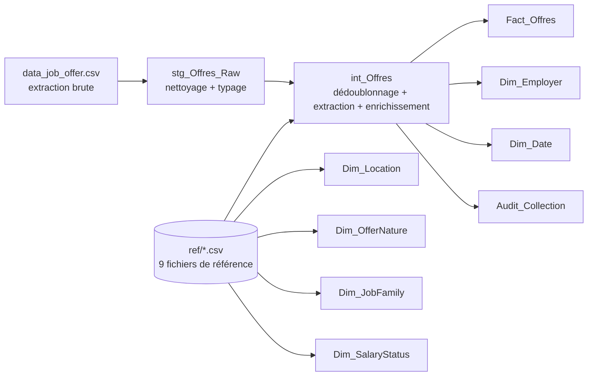
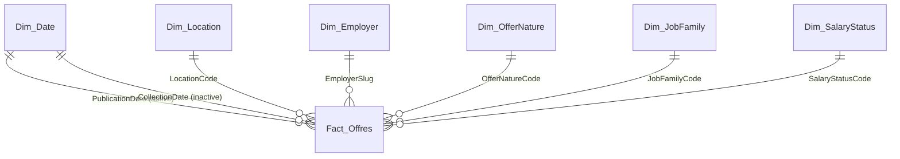

# Job Market Intelligence – Cameroun

> Tableau de bord Power BI de veille sur le marché de l'emploi camerounais : **qui recrute, où, pour quels métiers et à quelles conditions**, lu à partir d'annonces publiques, avec la fiabilité de chaque indicateur affichée en permanence.


**Auteur :** William Mbozo'o — Data Analyst & Engineer

---

## 1. Contexte métier

### Objectifs
Donner à un comité de pilotage une lecture fiable et immédiate du marché de l'emploi à partir d'une source ouverte unique : un portail d'annonces camerounais. Le rapport répond à six questions stratégiques :

| Page | Question décisionnelle |
|---|---|
| **00 Overview** | Quels sont les 4 chiffres clés et les 3 enseignements à retenir ? |
| **01 Publishing pace** | À quel rythme les annonces sont-elles publiées ? Quelle part a moins de 7 jours ? |
| **02 Territory** | Comment les offres se répartissent-elles par ville et région ? Quelles régions sont absentes ? |
| **03 Employers & jobs** | Qui publie le plus ? Quelles familles de métiers dominent ? Combien de postes par annonce ? |
| **04 Contracts & pay** | Quelle part de CDI/temps plein, de stages, d'appels d'offres ? Combien d'annonces affichent un salaire ? |
| **05 Data quality** | Quel taux de doublons, de descriptions manquantes, d'extraction réussie ? Jusqu'où se fier à chaque KPI ? |
| **06 Action plan & risks** | Quelles 3 priorités, quels gains, quels risques à provisionner ? |

Deux pages masquées complètent le rapport : **Offer detail** (drill-through vers la liste des annonces, avec lien vers l'annonce d'origine) et **tt_Offer** (infobulle personnalisée).

### Problématiques résolues
- **Données brutes bruitées** : chaque annonce apparaît deux fois dans l'extraction (200 lignes pour 100 annonces uniques), 38 % des annonces n'ont pas de description, le texte contient des caractères parasites (espaces insécables, largeur nulle).
- **Informations enfouies dans du texte libre** : localisation, date de publication, catégorie et salaire sont noyés dans un champ `description` ; l'employeur se lit dans l'URL (98 % de couverture contre 52 % dans la description).
- **Confiance dans les chiffres** : chaque KPI dépendant de la description affiche sa base (« 62 annonces décrites sur 100 ») et une page dédiée contrôle la qualité à chaque rafraîchissement.
- **Aucune règle métier codée en dur** : dictionnaires de mots-clés, correspondances de régions, d'employeurs et de statuts salariaux vivent dans des fichiers de référence (`ref/*.csv`) modifiables sans toucher au code.

### Résultats clés de la collecte du 12 octobre 2026

| Indicateur | Valeur |
|---|---|
| Lignes brutes → annonces uniques | 200 → **100** (50 % de doublons) |
| Postes annoncés | **416** |
| Annonces avec description | **62 %** (objectif 90 % : contrôle en échec, signalé dans le rapport) |
| Part des annonces de moins de 7 jours | **87 %** (54 sur 62 datées) |
| Poids de Douala + Yaoundé (annonces localisées) | **65 %** — 3 régions sans aucune annonce (Nord, Ouest, Sud) |
| Salaire « à négocier » | **89 %** des annonces décrites ; transparence salariale **4 %** |
| Contrôles qualité réussis | **5 / 6** |

> Le jeu de données est un **instantané** (une seule collecte) : aucune tendance annuelle n'est affirmée. Le modèle est prêt pour l'historisation (clé annonce × date de collecte, table d'audit par collecte).

---

## 2. Architecture des données

### Flux de transformation



Les requêtes sont organisées en cinq groupes Power Query : `00_Parameters`, `01_Functions`, `02_Reference`, `03_Staging` (non chargés) et `04_Model` (chargé). Le code M complet est dans [`scripts/power_query/`](scripts/power_query).

### Schéma en étoile



| Table | Rôle | Grain / clé |
|---|---|---|
| **`Fact_Offres`** | Table de faits | 1 ligne par annonce unique et par collecte · `OfferKey` = `OfferID\|yyyyMMdd` |
| `Dim_Date` | Calendrier généré (marqué table de dates) | `Date` · deux rôles : publication (active) et collecte (inactive, activable en DAX) |
| `Dim_Location` | Villes, régions, portée (ville / national / international) | `LocationCode` · les 10 régions sont semées via leur capitale pour qu'une région sans annonce reste visible |
| `Dim_Employer` | Employeur et type (ONG, banque, PME…) | `EmployerSlug` lu dans l'URL |
| `Dim_OfferNature` | Nature de l'annonce (CDI, stage, appel d'offres, formation…) | `OfferNatureCode` |
| `Dim_JobFamily` | Famille de métiers (finance, ingénierie, logistique…) | `JobFamilyCode` |
| `Dim_SalaryStatus` | Statut du salaire (négociable, chiffré, payant…) | `SalaryStatusCode` |
| `Audit_Collection` | Contrôle qualité par collecte (déconnectée) | `CollectionDate` |
| `_Measures` + 7 tables de support | Mesures, contrôles qualité (`QA_*`), registre de risques, plan d'action, paramètre what-if | tables déconnectées |

**Choix de conception**
- Relations *un-à-plusieurs*, filtre unidirectionnel, clés textuelles métier à faible cardinalité.
- **Membres « inconnus » explicites** (`NONE`, `UNMAPPED`, `unknown`, `MISSING`, `JOB_UNK`) : aucune ligne vide dans les segments, les données manquantes restent visibles et mesurables.
- Calendrier à **double rôle** (publication / collecte) plutôt que deux tables de dates.
- Colonnes clés masquées : l'utilisateur filtre par les dimensions.
- `RawRowCount` conservé sur le fait pour calculer le taux de doublons sans garder les lignes brutes.

---

## 3. Indicateurs de performance (KPIs)

Le modèle contient **151 mesures DAX** dans la table `_Measures`, classées en 10 dossiers d'affichage. Détail commenté dans [`dax/`](dax) ; sélection stratégique dans [`dax/mesures_cles.dax`](dax/mesures_cles.dax).

| Dossier | Mesures phares | Valeur ajoutée pour la direction |
|---|---|---|
| **01 Base** | `Offers`, `Raw Rows`, `Duplicate Rate %`, `Described Offers`, `Description Coverage %`, `Positions` | Volume réel du marché, ampleur du bruit, **base de calcul** de tous les KPI dépendants de la description |
| **02 Publishing pace** | `Recent Share %`, `Offers Last 7 Days`, `7-Day Change %`, `WoW Change %`, `Peak Day`, `Top 3 Weekdays Share %` | Rythme de publication, détection des pics, jours de diffusion dominants |
| **03 Territory** | `Located Offers`, `Top 2 Cities Share %`, `Nationwide Share %`, `Regions with No Offer` | Concentration géographique, zones blanches, part des offres nationales ou à l'étranger |
| **04 Employers & jobs** | `Employer Coverage %`, `Top Employer`, `Top Employer Type Share %`, `Positions per Job Offer`, `Top 2 Ads Positions Share %` | Qui domine le marché, concentration des postes sur quelques annonces |
| **05 Contracts & pay** | `Full-time Share %`, `Non-job Share %`, `Negotiable Share %`, `Salary Transparency Index %` | Qualité de l'emploi proposé, opacité salariale |
| **06 Data quality** | `Field Extraction Rate %`, `Funnel Value` / `Funnel Drop`, `QA Actual` / `QA Target` / `QA Pass`, `Checks Passed Label` | Fiabilité mesurée et traçable ; table de contrôle Pass / Fail à chaque rafraîchissement |
| **07 Action plan & risks** | `Time Saved per Refresh (h)`, `Time Saved per Year (h)`, `Weeks to First Trend`, `Risk Score`, `Risk Level` | Gains attendus du plan d'action (paramètre what-if : minutes de revue manuelle par annonce), priorisation des risques |
| **08 Labels & headlines** | `Headline Overview` … `Headline Action`, `KPI Line …`, `Base Label` | **Titres et sous-titres dynamiques** : aucun texte chiffré saisi à la main dans le rapport |
| **09 Formatting** | `Color Recency`, `Color Delta`, `Color QA`, `Color Risk Cell` … | Mise en forme conditionnelle pilotée par mesures : la palette vit à un seul endroit |
| **00 Targets & parameters** | `Target Description Coverage`, `Recent Window Days`, `Target Portals` … | Seuils et cibles sous forme de mesures, jamais codés dans les visuels |

**Techniques DAX mises en œuvre :** variables (`VAR`), fenêtres glissantes (`DATESBETWEEN`, `DATEADD`), classements dynamiques (`TOPN`, `RANKX`, `CONCATENATEX`), contexte de filtre (`CALCULATE`, `REMOVEFILTERS`, `ALLSELECTED`), mesures « SWITCH » pilotant des tables déconnectées (contrôles qualité, entonnoir, matrice de risques), mesures de couleur, relation inactive activable.

---

## 4. Aperçu visuel

Palette : fond blanc, cartes à bordure douce, bandeau vert nuit, teintes teal / aqua pour les données, ambre pour **l'élément à regarder**. Barre latérale de navigation, titre dynamique sous chaque titre de page, 4 cartes KPI par page.

> Ajouter les captures dans [`docs/screenshots/`](docs/screenshots) (PNG, 1920 × 1080) en conservant les noms ci-dessous.

| | |
|---|---|
|  |  |
| **00 Overview** | **01 Publishing pace** |
|  |  |
| **02 Territory** | **03 Employers & jobs** |
|  |  |
| **04 Contracts & pay** | **05 Data quality** |
|  |  |
| **06 Action plan & risks** | **Offer detail** (drill-through) |

Un GIF de navigation peut être placé dans `docs/screenshots/demo.gif` puis référencé ici : ``.

---

## 5. Guide de reproduction rapide

### Prérequis
- **Power BI Desktop** récent, avec les fonctionnalités d'aperçu *Power BI Project (.pbip)*, *format de définition de modèle TMDL* et *format de rapport PBIR* activées (Options → Fonctionnalités d'aperçu).
- **Azure Maps** activé (Options → Sécurité → *Utiliser les visuels Map et Filled Map*) pour la carte de la page Territory.
- Optionnel : **Node.js ≥ 20** (régénérer le rapport) et **Python ≥ 3.9** (profilage).

### Étapes
1. **Cloner** le dépôt : `git clone https://github.com/mbozoomengo/job-market-intelligence.git`
2. **Ouvrir** `Job_Market_Intelligence_Cameroon.pbip` dans Power BI Desktop.
3. **Fournir les données** : l'extraction brute n'est volontairement **pas publiée** (annonces tierces contenant des contacts de recruteurs). Placez votre propre fichier `data_job_offer.csv` — UTF-8, trois colonnes `titre`, `lien`, `description` — où vous voulez.
4. **Pointer les paramètres** : *Accueil → Transformer les données → Paramètres* :
   - `pSourcePath` : chemin complet de votre CSV ;
   - `pRefFolder` : chemin du dossier [`ref/`](ref) **avec antislash final** ;
   - `pCollectionDate` : date de la collecte (référence des calculs de récence).
5. **Actualiser**. Le modèle, les mesures et le rapport sont rechargés.

### Comprendre le modèle en 10 minutes
| Pour voir… | Aller à |
|---|---|
| Le code Power Query pas à pas | [`scripts/power_query/`](scripts/power_query) (`03_staging/int_Offres.pq` est la pièce maîtresse) |
| Toutes les mesures DAX, commentées | [`dax/`](dax) |
| Les règles métier modifiables | [`ref/`](ref) (mots-clés des familles de métiers, régions, employeurs, statuts salariaux) |
| La spécification du rapport | [`_brief/report-spec.md`](_brief/report-spec.md) |
| Le modèle brut (TMDL) | `Job_Market_Intelligence_Cameroon.SemanticModel/definition/` |
| Le rapport brut (PBIR) | `Job_Market_Intelligence_Cameroon.Report/definition/` |

### Outils du dépôt
```bash
python scripts/profil_extraction.py chemin/vers/data_job_offer.csv   # contrôle rapide de l'extraction
node _build/build_report.js                                          # régénère les pages du rapport (PBIR)
node _build/export_docs.js                                           # réexporte dax/ et scripts/power_query/ depuis le modèle
```

---

## 6. Structure du dépôt

```
.
├── Job_Market_Intelligence_Cameroon.pbip          # point d'entrée du projet Power BI
├── Job_Market_Intelligence_Cameroon.SemanticModel/ # modèle sémantique (TMDL)
├── Job_Market_Intelligence_Cameroon.Report/        # rapport (PBIR) : 9 pages, thème, icônes
├── dax/                                            # mesures DAX par dossier + sélection stratégique
├── scripts/
│   ├── power_query/                                # tout le code M (paramètres, fonctions, staging, modèle)
│   └── profil_extraction.py                        # profilage de l'extraction brute
├── ref/                                            # 9 fichiers de référence (règles métier)
├── _brief/report-spec.md                           # spécification et contrat de design du rapport
├── _build/                                         # générateurs (rapport PBIR, export de la documentation)
├── docs/screenshots/                               # captures d'écran du rapport
└── Job Market Intelligence – Cameroon.pptx         # présentation exécutive associée
```

---

## 7. Limites et pistes d'évolution

- **Couverture des descriptions de 62 %** : les KPI de localisation, de date, de contrat et de salaire reposent sur les annonces décrites et sont à lire comme indicatifs (base affichée). Piste : collecter la page détail de chaque annonce.
- **Source unique et instantané** : pas de tendance tant que 12 collectes hebdomadaires ne sont pas cumulées. Le dossier « Action plan » chiffre ce délai.
- **Classification par mots-clés** : table de correction manuelle prévue (`ref/ref_job_family_override.csv`).
- **Évolutions** : historisation par dossier de fichiers datés, actualisation incrémentale, passage en Lakehouse / Direct Lake sous Fabric, ajout de deux portails.

## 8. Données et éthique

Les données proviennent d'**annonces d'emploi publiques** ; aucune donnée de candidat n'est collectée. La source est citée dans chaque page du rapport. L'extraction brute n'est pas redistribuée dans ce dépôt.

---

*Projet réalisé à des fins de démonstration : modélisation en étoile, DAX, Power Query et storytelling visuel.*

---

Licence : [MIT](LICENSE).
