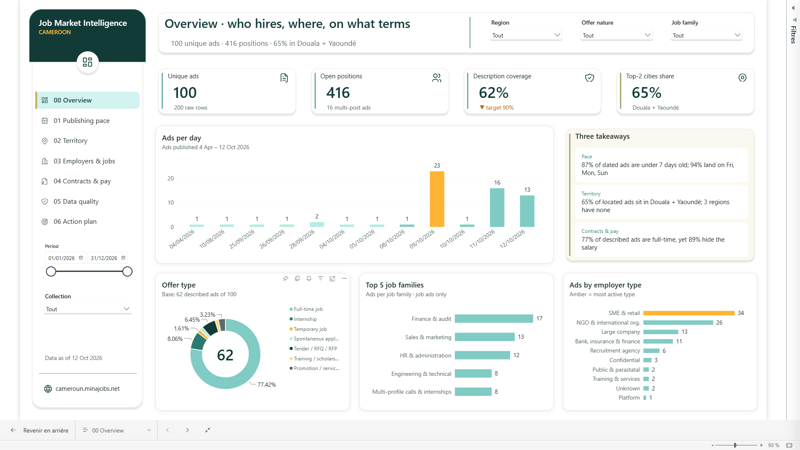

# Job Market Intelligence — Cameroun

> Tableau de bord Power BI et pipeline de données pour lire le marché de l'emploi camerounais à partir d'une source ouverte, avec la fiabilité de chaque indicateur affichée.

**Auteur : William Mbozo'o** — Ingénieur en systèmes d'information (Data / BI, Product Owner), Yaoundé.
[CV (PDF)](./CV_William_Mbozoo.pdf) · [Portfolio](https://william-mbozoo.me) · [LinkedIn](#contact)

---

## Table des matières
1. [Aperçu](#aperçu)
2. [Problème métier](#problème-métier)
3. [Insights et recommandations](#insights-et-recommandations)
4. [Architecture](#architecture)
5. [Mesures DAX clés](#mesures-dax-clés)
6. [Stack technique](#stack-technique)
7. [Données et éthique](#données-et-éthique)
8. [Limites et suite](#limites-et-suite)
9. [Démo et reproduction](#démo-et-reproduction)
10. [Transparence sur l'usage de l'IA](#transparence-sur-lusage-de-lia)
11. [Contact](#contact)

---

## Aperçu

| | |
|---|---|
| **Démo en ligne** | [Voir le dashboard](LIEN_A_AJOUTER) *(données publiques uniquement)* |
| **Présentation exécutive** | [`Job Market Intelligence – Cameroon.pptx`](./Job%20Market%20Intelligence%20%E2%80%93%20Cameroon.pptx) |
| **Pages du rapport** | 9 (dont 1 drill-through et 1 infobulle personnalisée) |
| **Mesures DAX** | 151, organisées en 10 dossiers |
| **Modèle** | Schéma en étoile, 1 table de faits, 6 dimensions |



## Problème métier

Un comité de pilotage veut une lecture **rapide et fiable** du marché de l'emploi, à partir d'un seul portail d'annonces camerounais. Trois obstacles :

- **Doublons** : chaque annonce apparaît deux fois (200 lignes brutes → 100 annonces uniques).
- **Descriptions manquantes** : 38 % des annonces n'en ont pas.
- **Champs utiles noyés dans du texte libre** : lieu, date, catégorie, salaire. L'employeur est extrait de l'URL (98 % de couverture contre 52 % via la description).

Choix de conception : chaque KPI dépendant des descriptions **affiche sa base** (ex. « 62 annonces décrites sur 100 ») pour éviter les conclusions abusives.

## Insights et recommandations

> Snapshot du 12 octobre 2026, collecte unique : aucune tendance annuelle n'est revendiquée.

| Constat | Chiffre | Décision proposée |
|---|---|---|
| Rythme de publication | 87 % des annonces datées publiées sur les 7 derniers jours | Planifier une collecte hebdomadaire pour suivre la dynamique |
| Concentration géographique | Douala + Yaoundé = 65 % des annonces localisées ; 3 régions sans annonce | Cibler les régions non couvertes pour les actions d'orientation et de partenariat |
| Transparence salariale | 89 % des annonces décrites indiquent « négociable » ; transparence réelle : 4 % | Ne pas bâtir d'analyse salariale sur cette source ; croiser avec une autre |
| Qualité de collecte | Descriptions à 62 % pour une cible de 90 % (contrôle en échec, signalé dans le rapport) | Scraper la page détail de chaque annonce avant toute analyse fine |

*Les recommandations sont des propositions d'analyste à valider avec les parties prenantes.*

## Architecture

```
CSV brut ──► stg_Offres_Raw ──► int_Offres ──► Fact_Offres ──► Rapport Power BI
 (3 col.)    nettoyage/typage   dédoublonnage    + 6 dimensions     (9 pages)
                                extraction
 ref/*.csv ─────────────────────► dimensions (règles métier éditables sans code)
```

**Modèle en étoile**
- **Faits** : `Fact_Offres` (1 ligne par annonce unique et par collecte, clé `OfferID|yyyyMMdd`)
- **Dimensions** : `Dim_Date` (rôle double : publication / collecte), `Dim_Location`, `Dim_Employer`, `Dim_OfferNature`, `Dim_JobFamily`, `Dim_SalaryStatus`
- **Support** : `Audit_Collection`, tables `QA_*`, registre des risques, plan d'action, paramètre what-if

**Choix de modélisation** : relations 1-N à filtre unidirectionnel, membres « inconnus » explicites (`UNMAPPED`, `MISSING`), clés masquées, `RawRowCount` conservé pour calculer le taux de doublons sans stocker les lignes brutes.

**Power Query** : 5 groupes (`00_Parameters`, `01_Functions`, `02_Reference`, `03_Staging`, `04_Model`).

## Mesures DAX clés

Sélection commentée : [`dax/mesures_cles.dax`](./dax/mesures_cles.dax). Catalogue complet dans [`dax/`](./dax).

Techniques mobilisées : `VAR`, `CALCULATE`, `REMOVEFILTERS`, `ALLSELECTED`, `DATESBETWEEN`, `DATEADD`, `TOPN`, `RANKX`, `CONCATENATEX`, relation inactive activée en DAX.

## Stack technique

`Power BI Desktop` · `DAX` · `Power Query (M)` · `Azure Maps` · `Python` (profilage) · `Node.js` (génération du rapport)

## Données et éthique

- **Source unique** : un portail public d'offres d'emploi au Cameroun, citée sur chaque page du rapport.
- **Aucune donnée candidat** n'est collectée.
- **Extraction brute non publiée** (annonces de tiers avec coordonnées de recruteurs). Un échantillon fictif peut être fourni dans `data/sample/`.

## Limites et suite

| Limite | Évolution prévue |
|---|---|
| Descriptions à 62 % : KPI lieu, date, contrat, salaire indicatifs | Scraping de la page détail |
| Snapshot unique : pas de tendance | Historique de fichiers datés + rafraîchissement incrémental |
| Classification par mots-clés | Table de correction manuelle (`ref/ref_job_family_override.csv`) |
| Un seul portail | 2 portails supplémentaires + Lakehouse / Direct Lake (Fabric) |

## Démo et reproduction

- **Démo** : lien en ligne ci-dessus et captures dans [`docs/screenshots/`](./docs/screenshots).
- **Fichiers du projet Power BI (.pbip)** : disponibles **sur demande** (voir [Contact](#contact)).

## Transparence sur l'usage de l'IA

Projet construit avec **assistance IA** (génération de code, documentation). La conception, les choix de modélisation, la validation des résultats et les recommandations sont de mon fait.

## Contact

- E-mail : williammengo79@gmail.com
- Portfolio : [william-mbozoo.me](https://www.william-mbozoo.me/itsm)
- LinkedIn : *https://www.linkedin.com/in/william-mbozoo/*

Licence : MIT
