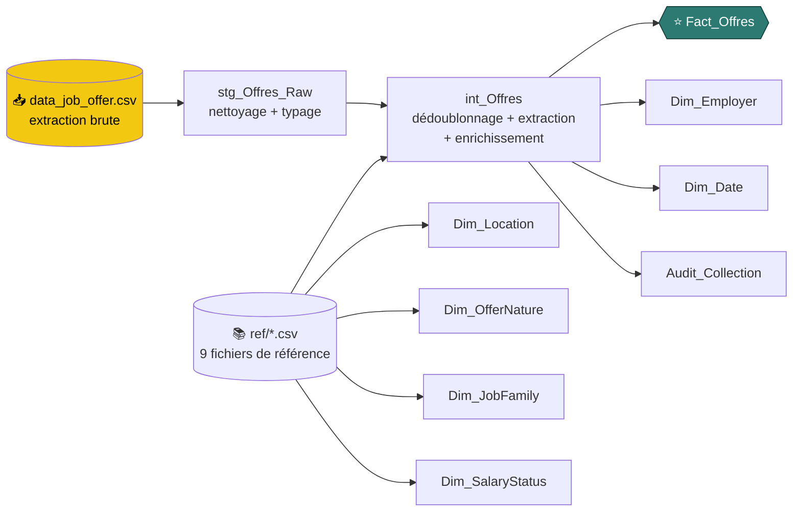
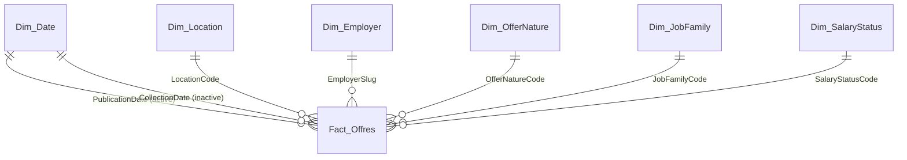
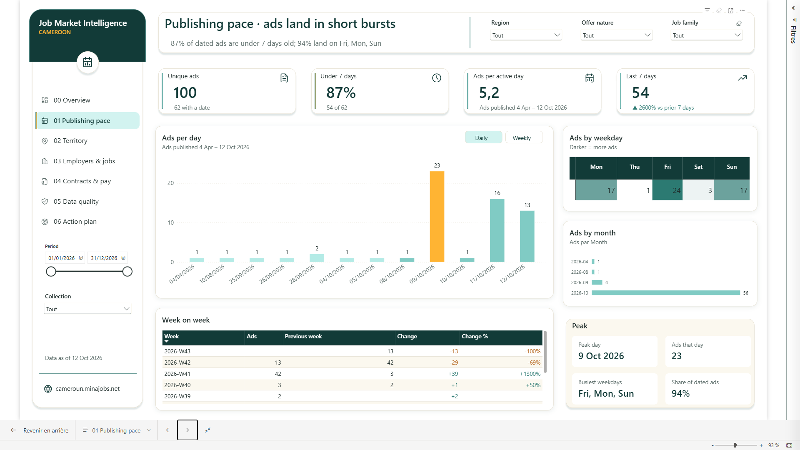
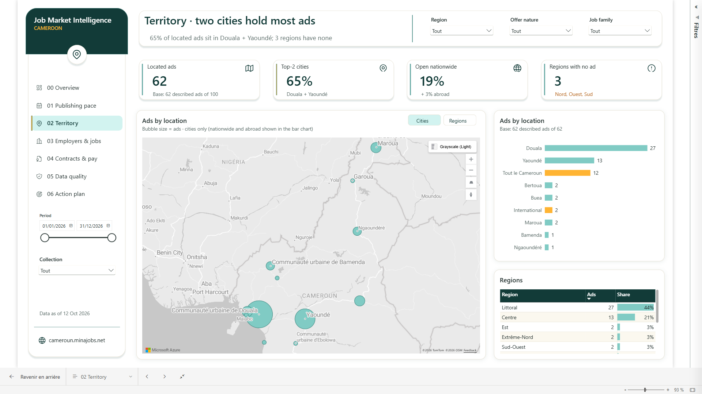
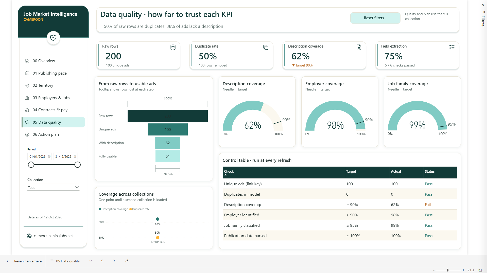

<div align="center">

# 🔎 Job Market Intelligence — Cameroun

### Qui recrute, où, pour quels métiers et à quelles conditions ?
**Un tableau de bord Power BI de veille sur le marché de l'emploi, où la fiabilité de chaque indicateur est affichée en permanence.**

<br>


<br>

[**Contexte**](#-1-contexte-métier) ·
[**Architecture**](#️-2-architecture-des-données) ·
[**KPIs**](#-3-indicateurs-de-performance) ·
[**Aperçu**](#-4-aperçu-visuel) ·
[**Reproduire**](#-5-guide-de-reproduction-rapide) ·
[**Limites**](#-7-limites-et-évolutions)

</div>

---

## ✨ En un coup d'œil

<div align="center">

| 📄 Annonces uniques | 👥 Postes annoncés | 🕒 Publiées < 7 jours | 🏙️ Douala + Yaoundé | ✅ Contrôles qualité |
|:---:|:---:|:---:|:---:|:---:|
| **100** | **416** | **87 %** | **65 %** | **5 / 6** |
| *sur 200 lignes brutes* | *par annonce : ~4* | *54 sur 62 datées* | *3 régions à zéro* | *1 contrôle en échec, signalé* |

</div>

> 📌 **Instantané du 12 octobre 2026** (une seule collecte) : aucune tendance annuelle n'est affirmée. Le modèle est prêt pour l'historisation.

---

## 🎯 1. Contexte métier

### Objectif
Donner à un comité de pilotage une lecture **fiable et immédiate** du marché de l'emploi, à partir d'une source ouverte unique : un portail d'annonces camerounais.

### Les questions auxquelles le rapport répond

| Page | Question décisionnelle |
|---|---|
| 🏠 **00 Overview** | Quels sont les 4 chiffres clés et les 3 enseignements à retenir ? |
| ⏱️ **01 Publishing pace** | À quel rythme publie-t-on ? Quelle part a moins de 7 jours ? |
| 🗺️ **02 Territory** | Comment se répartissent les offres par ville et région ? Quelles régions sont absentes ? |
| 🏢 **03 Employers & jobs** | Qui publie le plus ? Quelles familles de métiers dominent ? Combien de postes par annonce ? |
| 💼 **04 Contracts & pay** | Quelle part de CDI, de stages, d'appels d'offres ? Combien d'annonces affichent un salaire ? |
| 🛡️ **05 Data quality** | Quel taux de doublons, de descriptions manquantes, d'extraction réussie ? |
| 🚀 **06 Action plan & risks** | Quelles 3 priorités, quels gains, quels risques à provisionner ? |

Deux pages masquées complètent le rapport : **Offer detail** (drill-through vers la liste des annonces, avec lien vers l'annonce d'origine) et **tt_Offer** (infobulle personnalisée).

### Problèmes résolus

| 🧨 Problème | 🛠️ Réponse apportée |
|---|---|
| **Données brutes bruitées** : chaque annonce apparaît 2 fois (200 lignes pour 100 annonces), 38 % sans description, caractères parasites | Dédoublonnage, nettoyage du texte (espaces insécables, largeur nulle), taux de doublons mesuré |
| **Informations enfouies** dans un champ texte libre (lieu, date, catégorie, salaire) | Extraction par fonctions Power Query ; employeur lu dans l'URL (98 % de couverture contre 52 % dans la description) |
| **Confiance dans les chiffres** | Chaque KPI dépendant de la description affiche sa base (« 62 annonces décrites sur 100 ») ; une page dédiée contrôle la qualité à chaque rafraîchissement |
| **Règles métier codées en dur** | Mots-clés, régions, employeurs et statuts salariaux vivent dans `ref/*.csv`, modifiables sans toucher au code |

### Résultats clés de la collecte

| Indicateur | Valeur |
|---|---|
| Lignes brutes → annonces uniques | 200 → **100** (50 % de doublons) |
| Annonces avec description | **62 %** (objectif 90 % : contrôle en échec, signalé dans le rapport) |
| Annonces de moins de 7 jours | **87 %** (54 sur 62 datées) |
| Poids de Douala + Yaoundé | **65 %** des annonces localisées, 3 régions sans annonce (Nord, Ouest, Sud) |
| Salaire « à négocier » | **89 %** des annonces décrites · transparence salariale **4 %** |

---

## 🏗️ 2. Architecture des données

### Flux de transformation



Les requêtes Power Query sont rangées en **5 groupes** : `00_Parameters` · `01_Functions` · `02_Reference` · `03_Staging` (non chargés) · `04_Model` (chargé). Code complet dans [`scripts/power_query/`](scripts/power_query).

### Schéma en étoile



| Table | Rôle | Grain / clé |
|---|---|---|
| ⭐ **`Fact_Offres`** | Table de faits | 1 ligne par annonce unique et par collecte · `OfferKey` = `OfferID\|yyyyMMdd` |
| 📅 `Dim_Date` | Calendrier généré, marqué table de dates | `Date` · deux rôles : publication (active) et collecte (inactive) |
| 📍 `Dim_Location` | Villes, régions, portée (ville / national / international) | `LocationCode` · les 10 régions sont semées via leur capitale, une région sans annonce reste visible |
| 🏢 `Dim_Employer` | Employeur et type (ONG, banque, PME…) | `EmployerSlug`, lu dans l'URL |
| 📑 `Dim_OfferNature` | CDI, stage, appel d'offres, formation… | `OfferNatureCode` |
| 🧩 `Dim_JobFamily` | Finance, ingénierie, logistique… | `JobFamilyCode` |
| 💰 `Dim_SalaryStatus` | Négociable, chiffré, payant… | `SalaryStatusCode` |
| 🔍 `Audit_Collection` | Contrôle qualité par collecte (déconnectée) | `CollectionDate` |
| 🧮 `_Measures` + 7 tables de support | Mesures, contrôles `QA_*`, registre de risques, plan d'action, paramètre what-if | déconnectées |

<details>
<summary><b>🧠 Choix de conception (cliquer pour déplier)</b></summary>

<br>

- **Relations un-à-plusieurs**, filtre unidirectionnel, clés textuelles métier à faible cardinalité.
- **Membres « inconnus » explicites** (`NONE`, `UNMAPPED`, `unknown`, `MISSING`, `JOB_UNK`) : aucune ligne vide dans les segments, les données manquantes restent visibles et mesurables.
- **Calendrier à double rôle** (publication / collecte) plutôt que deux tables de dates.
- **Colonnes clés masquées** : l'utilisateur filtre par les dimensions.
- **`RawRowCount`** conservé sur le fait pour calculer le taux de doublons sans garder les lignes brutes.

</details>

---

## 📊 3. Indicateurs de performance

**151 mesures DAX** dans la table `_Measures`, classées en **10 dossiers**. Détail commenté dans [`dax/`](dax), sélection stratégique dans [`dax/mesures_cles.dax`](dax/mesures_cles.dax).

| Dossier | Mesures phares | 💡 Valeur pour la direction |
|---|---|---|
| 🧱 **01 Base** | `Offers` · `Raw Rows` · `Duplicate Rate %` · `Described Offers` · `Description Coverage %` · `Positions` | Volume réel du marché, ampleur du bruit, **base de calcul** des KPI dépendants de la description |
| ⏱️ **02 Publishing pace** | `Recent Share %` · `Offers Last 7 Days` · `7-Day Change %` · `WoW Change %` · `Peak Day` · `Top 3 Weekdays Share %` | Rythme de publication, pics, jours de diffusion dominants |
| 🗺️ **03 Territory** | `Located Offers` · `Top 2 Cities Share %` · `Nationwide Share %` · `Regions with No Offer` | Concentration géographique, zones blanches |
| 🏢 **04 Employers & jobs** | `Employer Coverage %` · `Top Employer` · `Top Employer Type Share %` · `Positions per Job Offer` · `Top 2 Ads Positions Share %` | Qui domine le marché, concentration des postes |
| 💼 **05 Contracts & pay** | `Full-time Share %` · `Non-job Share %` · `Negotiable Share %` · `Salary Transparency Index %` | Qualité de l'emploi proposé, opacité salariale |
| 🛡️ **06 Data quality** | `Field Extraction Rate %` · `Funnel Value` / `Funnel Drop` · `QA Actual` / `QA Target` / `QA Pass` · `Checks Passed Label` | Fiabilité mesurée et traçable, Pass / Fail à chaque rafraîchissement |
| 🚀 **07 Action plan & risks** | `Time Saved per Refresh (h)` · `Time Saved per Year (h)` · `Weeks to First Trend` · `Risk Score` · `Risk Level` | Gains du plan (what-if : minutes de revue manuelle par annonce), priorisation des risques |
| 🏷️ **08 Labels & headlines** | `Headline Overview` … `Headline Action` · `KPI Line …` · `Base Label` | **Titres dynamiques** : aucun texte chiffré saisi à la main |
| 🎨 **09 Formatting** | `Color Recency` · `Color Delta` · `Color QA` · `Color Risk Cell` … | Mise en forme conditionnelle pilotée par mesures, palette centralisée |
| 🎯 **00 Targets & parameters** | `Target Description Coverage` · `Recent Window Days` · `Target Portals` … | Seuils et cibles sous forme de mesures, jamais codés dans les visuels |

### 🧪 Techniques DAX mises en œuvre

`VAR` · fenêtres glissantes (`DATESBETWEEN`, `DATEADD`) · classements dynamiques (`TOPN`, `RANKX`, `CONCATENATEX`) · contexte de filtre (`CALCULATE`, `REMOVEFILTERS`, `ALLSELECTED`) · mesures « SWITCH » pilotant des tables déconnectées (QA, entonnoir, matrice de risques) · mesures de couleur · relation inactive activée en DAX

---

## 🖼️ 4. Aperçu visuel

**Palette** : fond blanc, cartes à bordure douce, bandeau vert nuit, teintes teal / aqua pour les données, **ambre pour l'élément à regarder**. Barre latérale de navigation, titre dynamique sous chaque titre de page, 4 cartes KPI par page.

> 📸 Déposez vos captures (PNG 1920 × 1080) dans [`docs/screenshots/`](docs/screenshots) en gardant les noms ci-dessous.

<table>
  <tr>
    <td align="center"><br><b>00 · Overview</b></td>
    <td align="center"><br><b>01 · Publishing pace</b></td>
  </tr>
  <tr>
    <td align="center"><br><b>02 · Territory</b></td>
    <td align="center"><br><b>03 · Employers & jobs</b></td>
  </tr>
  <tr>
    <td align="center"><br><b>04 · Contracts & pay</b></td>
    <td align="center"><br><b>05 · Data quality</b></td>
  </tr>
  <tr>
    <td align="center"><br><b>06 · Action plan & risks</b></td>
    <td align="center"><br><b>Offer detail</b> (drill-through)</td>
  </tr>
</table>

<div align="center">

<!-- Décommentez quand le GIF est prêt :

-->

</div>

---

## 🚀 5. Guide de reproduction rapide

### Prérequis

- ✅ **Power BI Desktop** récent, avec les aperçus **Power BI Project (.pbip)**, **TMDL** et **PBIR** activés (*Options → Fonctionnalités d'aperçu*)
- ✅ **Azure Maps** activé (*Options → Sécurité → Utiliser les visuels Map et Filled Map*) pour la carte de la page Territory
- ➕ Optionnel : **Node.js ≥ 20** (régénérer le rapport) et **Python ≥ 3.9** (profilage)

### Étapes

```bash
git clone https://github.com/mbozoomengo/job-market-intelligence.git
cd job-market-intelligence
```

1. **Ouvrir** `Job_Market_Intelligence_Cameroon.pbip` dans Power BI Desktop.
2. **Fournir les données.** L'extraction brute n'est volontairement **pas publiée** (annonces tierces contenant des contacts de recruteurs). Placez votre propre `data_job_offer.csv`, en UTF-8, avec trois colonnes : `titre`, `lien`, `description`.
3. **Pointer les paramètres** (*Accueil → Transformer les données → Paramètres*) :

   | Paramètre | Valeur attendue |
   |---|---|
   | `pSourcePath` | Chemin complet de votre CSV |
   | `pRefFolder` | Chemin du dossier [`ref/`](ref) **avec antislash final** |
   | `pCollectionDate` | Date de la collecte (référence des calculs de récence) |

4. **Actualiser** : modèle, mesures et rapport se rechargent.

### 🧭 Comprendre le modèle en 10 minutes

| Pour voir… | Aller à |
|---|---|
| Le code Power Query pas à pas | [`scripts/power_query/`](scripts/power_query) · pièce maîtresse : `03_staging/int_Offres.pq` |
| Toutes les mesures DAX commentées | [`dax/`](dax) |
| Les règles métier modifiables | [`ref/`](ref) |
| La spécification du rapport | [`_brief/report-spec.md`](_brief/report-spec.md) |
| Le modèle brut (TMDL) | `Job_Market_Intelligence_Cameroon.SemanticModel/definition/` |
| Le rapport brut (PBIR) | `Job_Market_Intelligence_Cameroon.Report/definition/` |

### 🧰 Outils du dépôt

```bash
python scripts/profil_extraction.py chemin/vers/data_job_offer.csv   # contrôle rapide de l'extraction
node _build/build_report.js                                          # régénère les pages du rapport (PBIR)
node _build/export_docs.js                                           # réexporte dax/ et scripts/power_query/ depuis le modèle
```

---

## 📁 6. Structure du dépôt

```text
.
├── 📦 Job_Market_Intelligence_Cameroon.pbip           # point d'entrée du projet Power BI
├── 🧠 Job_Market_Intelligence_Cameroon.SemanticModel/ # modèle sémantique (TMDL)
├── 📊 Job_Market_Intelligence_Cameroon.Report/        # rapport (PBIR) : 9 pages, thème, icônes
├── 🧮 dax/                                            # mesures DAX par dossier + sélection stratégique
├── ⚙️ scripts/
│   ├── power_query/                                   # code M : paramètres, fonctions, staging, modèle
│   └── profil_extraction.py                           # profilage de l'extraction brute
├── 📚 ref/                                            # 9 fichiers de référence (règles métier)
├── 📝 _brief/report-spec.md                           # spécification et contrat de design
├── 🔨 _build/                                         # générateurs (rapport PBIR, export de la documentation)
├── 🖼️ docs/screenshots/                               # captures d'écran du rapport
└── 🎞️ Job Market Intelligence – Cameroon.pptx         # présentation exécutive associée
```

---

## 🔭 7. Limites et évolutions

| ⚠️ Limite | 🛣️ Piste |
|---|---|
| **Descriptions à 62 %** : les KPI de lieu, date, contrat et salaire sont indicatifs (base affichée) | Collecter la page détail de chaque annonce |
| **Source unique, instantané** : pas de tendance avant 12 collectes hebdomadaires (délai chiffré dans « Action plan ») | Historisation par dossier de fichiers datés, actualisation incrémentale |
| **Classification par mots-clés** | Table de correction manuelle prévue (`ref/ref_job_family_override.csv`) |
| **Un seul portail** | Ajouter deux portails ; passage en Lakehouse / Direct Lake sous Fabric |

## ⚖️ 8. Données et éthique

Les données proviennent d'**annonces d'emploi publiques** ; **aucune donnée de candidat** n'est collectée. La source est citée sur chaque page du rapport. L'extraction brute n'est pas redistribuée dans ce dépôt.

---

<div align="center">

**👤 William Mbozo'o** · Data Analyst & Engineer
🔗 [github.com/mbozoomengo](https://github.com/mbozoomengo)

*Projet réalisé à des fins de démonstration : modélisation en étoile, DAX, Power Query et storytelling visuel.*

Licence [MIT](LICENSE)

</div>
